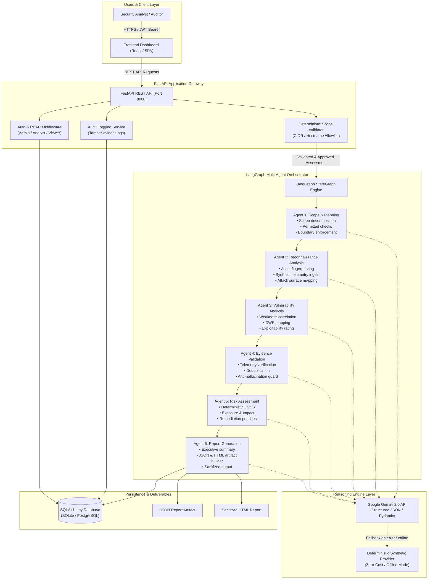

# SentinelAI — System Architecture Specification

## 1. Executive Summary & Vision

**SentinelAI** is an enterprise-grade multi-agent penetration testing and security assessment platform designed to automate offensive reconnaissance, vulnerability analysis, evidence validation, deterministic risk rating, and executive report synthesis. 

Unlike naive LLM wrappers that hallucinate exploits or execute unconstrained commands, SentinelAI is built around a **dual-plane architecture**:
1. **Control & Safety Plane (Deterministic):** Non-negotiable backend authorization, strict CIDR/DNS scope allowlists, SSRF protection filters, Role-Based Access Control (RBAC), and human-in-the-loop approval gates.
2. **Cognitive Reasoning Plane (Agentic):** A 6-agent directed acyclic workflow orchestrated via **LangGraph**, leveraging Google's **Gemini 2.0** LLM for contextual reasoning while falling back gracefully to deterministic telemetry analysis during offline or zero-cost execution.

---

## 2. Logical Architecture Diagram

---

## 3. Component Breakdown

### 3.1 Client Layer (Frontend Dashboard)
- **Tech Stack:** Modern responsive SPA (Vanilla JS + Vite/React compatible), CSS custom design system with dark-mode glassmorphism.
- **Key Views:** Security Operations Overview, Assessment Manager, 6-Agent StateGraph Workflow Visualizer, Findings Explorer, Audit Log Inspector, System Config & Health.
- **Delivery:** Auto-mounted directly on FastAPI root (`http://localhost:8000/`) for immediate, zero-friction local execution.

### 3.2 Security Gateway (FastAPI)
- **Role-Based Access Control (RBAC):**
  - `Admin`: Full permissions (create, approve, run, stop, inspect all assessments, view global audit logs).
  - `Analyst`: Assessment creation, scope attestation, approval, workflow execution, findings inspection for owned assessments.
  - `Viewer`: Read-only inspection of permitted assessments and reports.
- **Scope & SSRF Shield:**
  - Enforces strict CIDR matching (defaulting to safe lab subnets: `192.168.1.0/24`, `10.0.0.0/8`, `lab.local`).
  - Blocks loopback (`127.0.0.1`, `localhost`), link-local/cloud metadata (`169.254.169.254`), and arbitrary public internet destinations.
- **Tenant Isolation:**
  - Assessments, findings, and reports are isolated by `owner_id`; analysts cannot query or tamper with foreign assessments.

### 3.3 Multi-Agent Orchestration (LangGraph)
- **State Machine:** Built using `langgraph.graph.StateGraph`.
- **Shared Typed State (`AssessmentState`):**
  - Carries immutable scope boundaries, telemetry logs, candidate findings, validated findings, scored risks, and execution summaries.
- **Execution Isolation:**
  - Agents receive read-only slices of prior state and output strictly typed updates.
  - Agent 4 acts as a mandatory validation gate before Agent 5 calculates risks.

### 3.4 Intelligence Layer (Gemini 2.0 & Deterministic Fallback)
- **Official SDK Integration:** Utilizes `google-genai` with model `gemini-2.0-flash`.
- **Defensive Error Handling:**
  - Strict timeout limits (30s) and bounded retry loops.
  - Pydantic schema validation for all model responses.
  - Transparent fallback to `SyntheticEvidenceProvider` whenever `GEMINI_API_KEY` is absent, quota is exceeded, or offline demo mode is activated.

### 3.5 Persistence Layer
- **SQLAlchemy 2.0 ORM:**
  - Default: Zero-configuration SQLite (`sentinel_ai.db`).
  - Production: Configurable PostgreSQL via `DATABASE_URL`.
- **Auditing:**
  - Append-only `AuditLog` records for every administrative, assessment, approval, and report access event.
